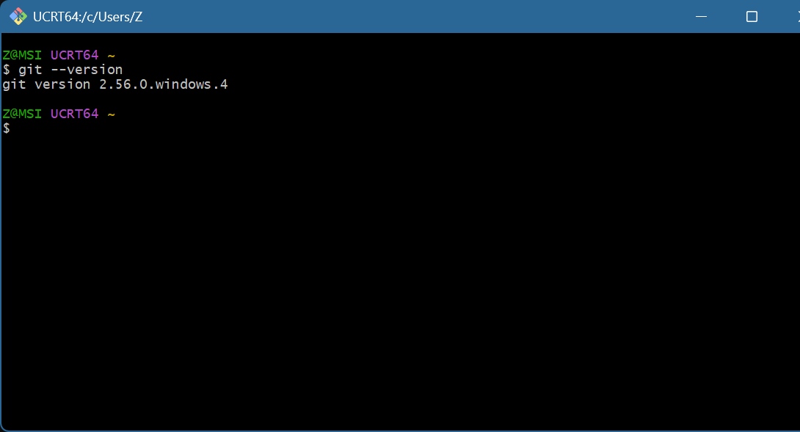
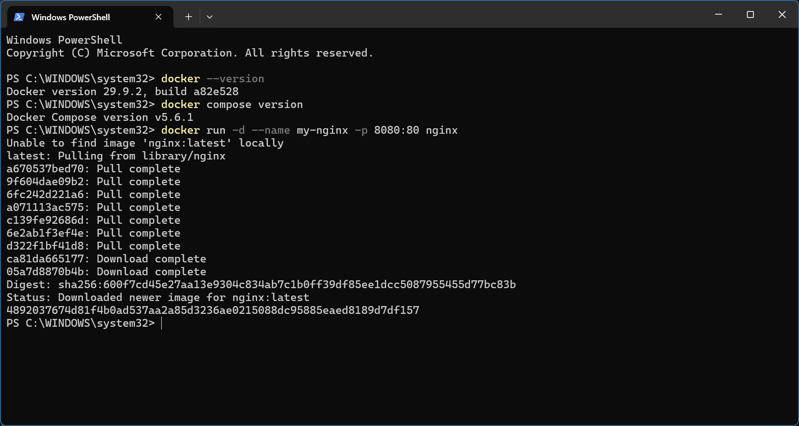
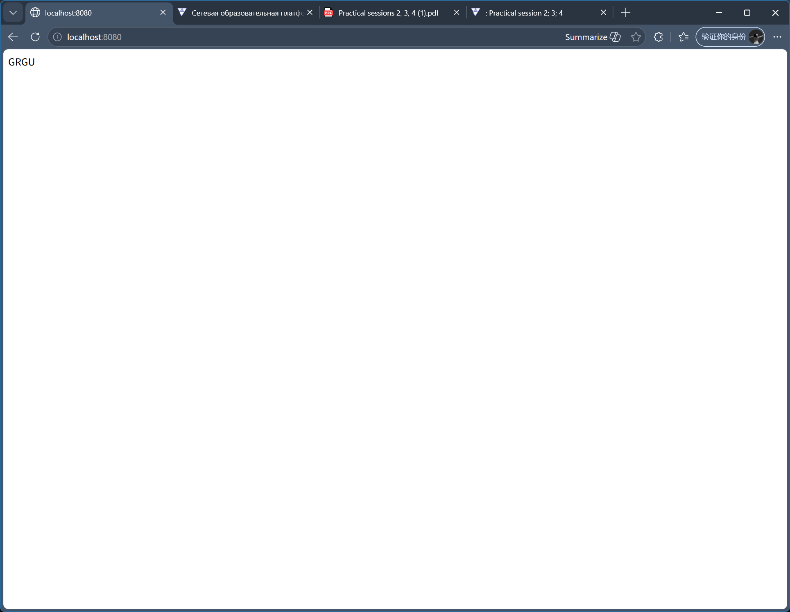

# Practical 2, 3, 4 Lab Report

## 1 & 3. Software Installation and Versions
Git, Docker, and Docker Compose have been successfully installed.

**Git version:**

**Docker and Compose versions:**

## 2. Download Practical 3 Repository
Successfully cloned the remote repository of Practical 3 to the local machine.

## 6. Run Nginx Container and Modify Homepage
Used the following command to pull and run the Nginx container:
`docker run -d --name my-nginx -p 8080:80 nginx`

Modified the content of `index.html` inside the container, replacing it with "GRGU".
The verification result of accessing `http://localhost:8080` is as follows:

## 7 & 8. Project Description
This project completed all the basic requirements of Practical 2, 3, and 4, including environment configuration, Docker container operations, and Git branch management.
